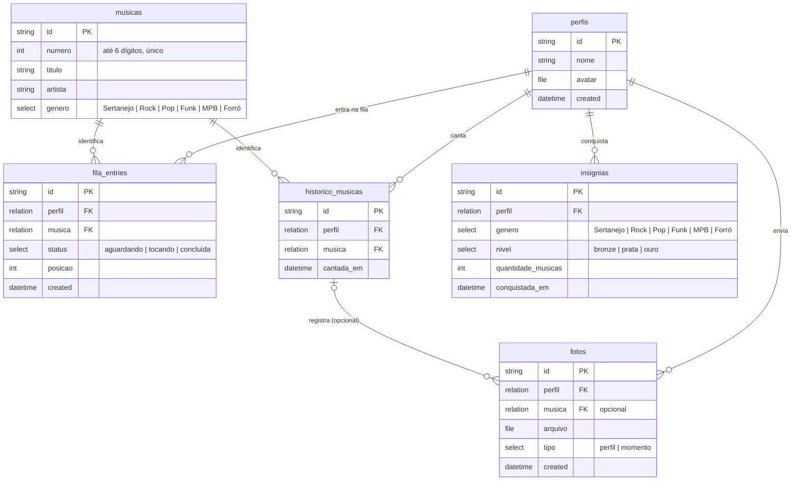

# Julius Fila — App Mobile

Aplicativo mobile (Android/iOS, via Expo) para gerenciar a fila de karaokê do Julius. Complementa o painel web existente, focado na experiência do cliente: entrar na fila, acompanhar a posição e colecionar insígnias pelas músicas cantadas.

## Sobre o app

O app permite que o cliente entre na fila do karaokê pelo celular, acompanhe sua posição em tempo real e ganhe insígnias conforme canta músicas de diferentes gêneros (ex: 5 músicas de rock = insígnia de bronze, 10 = prata). Opcionalmente, permite subir uma foto do momento no palco.

**Funcionalidades básicas (prioritárias):**

- [ ] Cadastro/identificação simples do cliente (nome, sem senha)
- [ ] Entrar na fila informando o número da música (até 6 dígitos) — gênero é resolvido automaticamente pelo catálogo no banco, não é escolhido manualmente
- [ ] Ver posição atual na fila
- [ ] Ver status da música (aguardando / tocando / concluída)
- [ ] Histórico de músicas já cantadas pelo cliente
- [ ] Cálculo e exibição de insígnias por gênero (baseado na quantidade de músicas cantadas)

> Todas as telas dessas funcionalidades já existem e estão populadas com dados mockados (ver [Planejamento de sprints](#planejamento-de-sprints)). Os itens serão marcados quando funcionarem com o banco (Sprints 3–5).

**Funcionalidades adicionais (trabalhos futuros):**

- [ ] Upload de foto do momento no palco (vinculada ao perfil ou à música) — interface pronta, falta câmera/galeria
- [ ] Compartilhar insígnia conquistada (imagem/redes sociais)
- [ ] Notificação local quando a vez estiver próxima
- [ ] Ranking de clientes por insígnias

## Como rodar

```bash
npm install          # o .npmrc já aceita o peer dependency do React Native Elements
npx expo start -c    # escanear o QR code com o Expo Go (SDK 57)
```

## Protótipos de tela

Protótipo no Figma (mapa de telas): **[Julius Fila - Protótipos](https://www.figma.com/design/gi5gQYkMtRoWRHfHBSqeVc?node-id=2-10)**

Telas: Home, Entrar na Fila, Minha Fila (posição/status em tempo real), Perfil com Insígnias por gênero, Upload de Foto (opcional). O app implementa esse layout (cores, fontes Inter/Oswald, BottomNav, BadgeCard) e acrescenta Identificação, Criar perfil e Detalhes da música no mesmo estilo.

## Modelagem do banco

Banco **remoto**, via **[PocketBase](https://pocketbase.io/)**. App consome REST + realtime pelo SDK oficial (`pocketbase` no npm). Troca a versão 100% local por fila de verdade compartilhada entre aparelhos, e ganha storage de arquivo nativo pro upload de foto — sem precisar gerenciar URI de imagem no dispositivo.

Música não é texto livre: o cliente informa apenas um **número de catálogo (até 6 dígitos)**. O gênero não é escolhido por quem entra na fila — vem fixo no cadastro da música (campo `select` na própria collection `musicas`), resolvido automaticamente a partir do número informado.

Cada entidade abaixo é uma **collection** no PocketBase. Diferenças de plataforma em relação a um schema SQL tradicional:

- `id` é string (15 caracteres, gerado automaticamente) — não int autoincrement. Toda relation aponta para esse `id`, nunca para um campo de negócio.
- Por isso `musicas.numero` deixa de ser PK: vira campo comum com índice único, e `id` (interno) assume o papel de chave.
- `created` / `updated` são automáticos em toda collection — dispensam os `criado_em` manuais do desenho anterior.
- Campos que eram `FK int` viram campo tipo **relation**.
- `genero`, `status`, `nivel` e `tipo` (valores fixos e pequenos) viram campo tipo **select** — equivalente do CHECK-enum, editável pela UI do PocketBase sem migração. Gênero não tem collection própria: é select fixo em `musicas` (e repetido em `insignias`, que é um resumo por perfil + gênero).
- `fotos` usa campo tipo **file** nativo (upload direto, sem lógica de persistência local).

Os tipos TypeScript em `types/index.ts` espelham essas collections, e os mocks em `mocks/` seguem os mesmos tipos — na Sprint 3 os mocks são trocados pelo SDK sem alterar as telas.



## Planejamento de sprints

Tarefas marcadas com *(nova)* não estavam previstas no planejamento inicial.

### Sprint 1 — semanas 1–2 ✅

- [x] Setup do projeto Expo
- [x] Protótipo de telas no Figma
- [x] Modelagem do banco (PocketBase)
- [x] Navegação entre telas com Expo Router
- [x] Atualização do Expo para o SDK 57, exigido pelo Expo Go do iOS *(nova)*

### Sprint 2 — semanas 3–4 ✅

- [x] Tema, tipos e dados mockados (`theme/`, `types/`, `mocks/`)
- [x] Componentes reutilizáveis (`components/`)
- [x] Design system do Figma com NativeWind: paleta, fontes Inter/Oswald e classes globais *(nova)*
- [x] React Native Elements no campo de texto *(nova)*
- [x] Telas Identificação e Criar perfil *(nova)*
- [x] Telas estáticas com dados mockados: Home, Entrar na Fila, Minha Fila, Perfil
- [x] Tela de detalhes da música com rota dinâmica `/musica/[numero]` *(nova)*
- [x] Interface da tela Foto do momento, adiantada da Sprint 6 *(nova)*
- [x] Navegação 100% por elementos clicáveis (BottomNav, links, "‹ Voltar") e hook `useNavigationExitOnBack` *(nova)*

### Sprint 3 — semanas 5–6

- [ ] Setup do PocketBase (self-host) + collections do modelo
- [ ] Integração via SDK: CRUD de perfil e fila (trocar `mocks/` pelo SDK)

### Sprint 4 — semanas 7–8

- [ ] Estado global da fila com Zustand (`states/useFila.ts`) *(nova)*
- [ ] Lógica de fila: entrar/sair, cálculo de posição, atualização de status
- [ ] Ações "Confirmar entrada" e "Cancelar minha entrada" alterando a fila

### Sprint 5 — semanas 9–10

- [ ] Sistema de insígnias: histórico de músicas por gênero, cálculo de níveis
- [ ] Tela de conquistas alimentada pelo banco

### Sprint 6 — semanas 11–12

- [ ] Upload de foto (expo-image-picker) na tela Foto do momento
- [ ] Polimento de UI, testes manuais e ajustes finais

## Atualizações desde o último checkpoint

### Recursos dos módulos anteriores aplicados

- **Expo Router** — navegação por arquivos em `app/`, seguindo o modelo da disciplina:
  - `app/_layout.tsx`: Stack raiz, carrega as fontes e define o `title` de todas as rotas;
  - `app/(auth)/_layout.tsx`: Tabs com a tab bar substituída pelo componente `BottomNav` do Figma (prop `tabBar`);
  - `app/(auth)/(home)/_layout.tsx`: Stack aninhado dentro da aba Home;
  - `app/musica/[numero].tsx`: rota dinâmica, lida com `useLocalSearchParams`;
  - navegação com `Link`, `router.push`, `router.replace` e `router.dismissTo`.
- **NativeWind (Tailwind)** — todas as telas e componentes estilizados com `className`. Tema global em duas camadas: tokens no `tailwind.config.js` (paleta lida de `theme/colors.ts`, fontes, escala de texto, raios) e classes semânticas no `global.css` com `@layer components` + `@apply` (`hero`, `titulo`, `btn-primary`, `fila-item`, `insignia`...).
- **React Native Elements** — `Input` do RNE dentro do componente `components/Input.tsx`, estilizado com as cores do Figma e com barra "Concluído" no teclado numérico do iOS.
- **Hook de navegação** — `hooks/useNavigationExitOnBack.ts` (padrão da aula): nas telas raiz, o voltar do Android fecha o app em vez de voltar para a identificação.
- **expo-image + expo-font** — ícones SVG exportados do Figma (BottomNav, avatar) e fontes Inter/Oswald do Google Fonts.

### Boas práticas de componentes reutilizáveis

| Conceito | Onde apliquei |
| -------- | ------------- |
| Isolamento de componentes que se repetem | `QueueCard` (cada item da fila), `InsigniaBadge` (cada gênero), `Chip` (cada gênero) |
| Nomenclatura minimalista e descritiva | `Screen`, `Hero`, `Card`, `Chip`, `QueueCard`, `BackLink`, `BottomNav` |
| Parametrização | `Button` (`variant`: primary/secondary/outline), `Hero` (`tone`, `align`), `InsigniaBadge` (`genero`, `nivel`, `quantidade`), `QueueCard` (`entry`, `voce`) |
| Mocks para popular a interface | `mocks/` (catálogo, perfil, fila, histórico, insígnias), tipados por `types/` |
| Componentes que recebem filhos (`children`) | `Screen`, `Card`, `Hero` |
| Componentes compostos (agrupamento de exports) | `Card` + `Card.Title` + `Card.Body`; `Hero` + `Hero.Pill`; `components/index.ts` reúne os exports |
| Componentes que disparam eventos para o pai | `Button` (`onPress`), `QueueCard` (`onPress` abre os detalhes), `Chip` (`onPress`), `Input` (`onChangeText`) |
